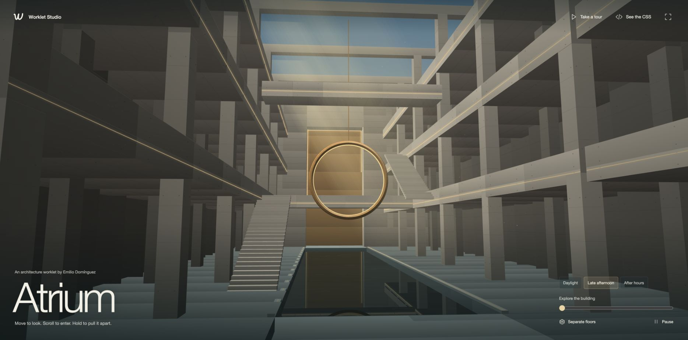
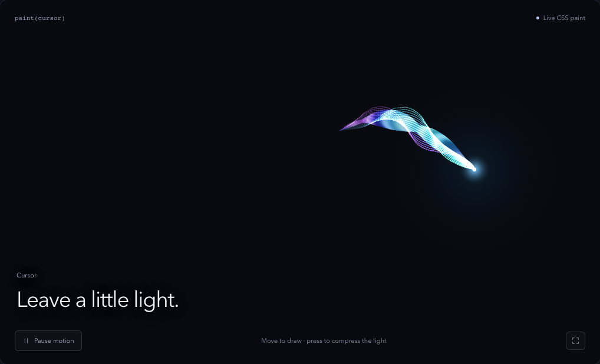
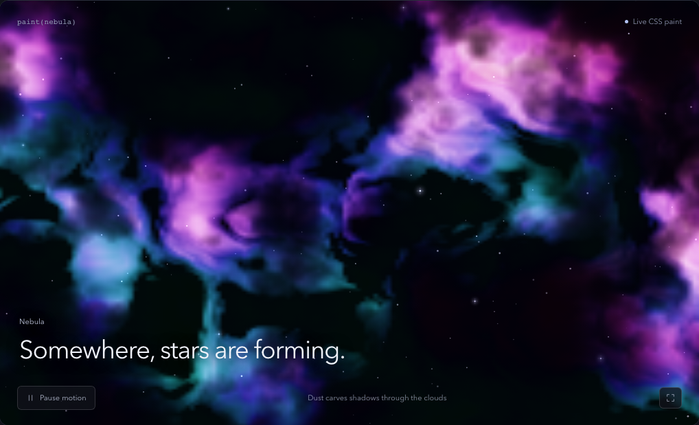
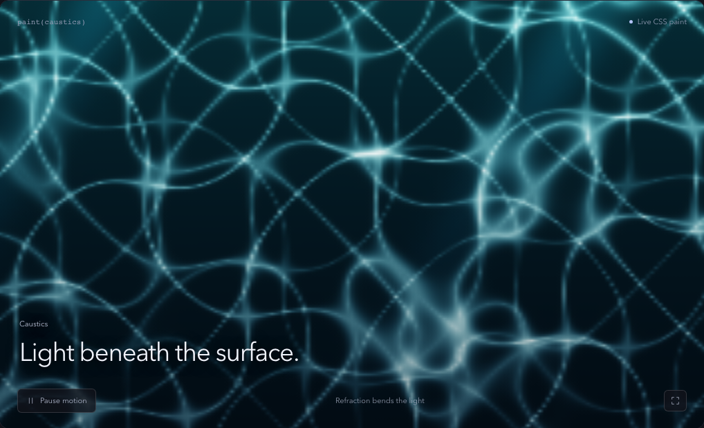

# Worklet Studio

**This building is a CSS background.**

[](https://emiliodominguez.github.io/worklet-studio/atrium.html)

[Enter the atrium](https://emiliodominguez.github.io/worklet-studio/atrium.html) · [Try all 13 effects](https://emiliodominguez.github.io/worklet-studio/) · [CodePen collection](https://codepen.io/collection/bNWgYw)

Move to look around. Scroll into the building. Hold to separate its floors, or take the camera tour.

Thirteen CSS Paint worklets for architecture, animated cursors, particles and procedural materials. Each is a small npm package with zero runtime dependencies. The studio has 46 presets and controls for editing the CSS properties behind each effect.

The renderers are JavaScript programs loaded through the CSS Paint API. Their output is used by `background-image: paint(...)`; CSS properties control the scene and animation. No WebGL, Three.js, canvas elements or prerecorded visuals.

Use Chrome or Edge for the live effects. Other browsers receive a static fallback.

| Animated cursors                                                                                                          | Nebula                                                                                                                     | Water caustics                                                                                                                     |
| ------------------------------------------------------------------------------------------------------------------------- | -------------------------------------------------------------------------------------------------------------------------- | ---------------------------------------------------------------------------------------------------------------------------------- |
| [](https://emiliodominguez.github.io/worklet-studio/#effect=cursor) | [](https://emiliodominguez.github.io/worklet-studio/#effect=nebula) | [](https://emiliodominguez.github.io/worklet-studio/#effect=caustics) |

## Packages

All thirteen are available on npm. Package links below open their installation instructions and CSS controls.

| Package                                               | npm                                                       | Paint name     | Effect                                                         |
| ----------------------------------------------------- | --------------------------------------------------------- | -------------- | -------------------------------------------------------------- |
| [particles-worklet](packages/particles-worklet)       | [npm](https://www.npmjs.com/package/particles-worklet)    | `particles`    | Animated constellations and three-arm spiral galaxies          |
| [cursor-worklet](packages/cursor-worklet)             | [npm](https://www.npmjs.com/package/cursor-worklet)       | `cursor`       | Silk trails, comets, plasma, glass lenses, ripples, and orbits |
| [aurora-worklet](packages/aurora-worklet)             | [npm](https://www.npmjs.com/package/aurora-worklet)       | `aurora`       | Folded spectral ribbons and auroral curtains                   |
| [flow-field-worklet](packages/flow-field-worklet)     | [npm](https://www.npmjs.com/package/flow-field-worklet)   | `flow-field`   | Generative magnetic streamlines                                |
| [ripple-worklet](packages/ripple-worklet)             | [npm](https://www.npmjs.com/package/ripple-worklet)       | `ripple`       | Liquid wavefronts and interference patterns                    |
| [iridescence-worklet](packages/iridescence-worklet)   | [npm](https://www.npmjs.com/package/iridescence-worklet)  | `iridescence`  | Shimmering foil and contour surfaces                           |
| [caustics-worklet](packages/caustics-worklet)         | [npm](https://www.npmjs.com/package/caustics-worklet)     | `caustics`     | Curved underwater light cells                                  |
| [vortex-worklet](packages/vortex-worklet)             | [npm](https://www.npmjs.com/package/vortex-worklet)       | `vortex`       | Tilted accretion disks and gravitational light arcs            |
| [terrain-worklet](packages/terrain-worklet)           | [npm](https://www.npmjs.com/package/terrain-worklet)      | `terrain`      | Animated topographic wave contours                             |
| [nebula-worklet](packages/nebula-worklet)             | [npm](https://www.npmjs.com/package/nebula-worklet)       | `nebula`       | Emission clouds, dust lanes, and parallax stars                |
| [metaballs-worklet](packages/metaballs-worklet)       | [npm](https://www.npmjs.com/package/metaballs-worklet)    | `metaballs`    | Merging liquid forms with reflective surface normals           |
| [kaleidoscope-worklet](packages/kaleidoscope-worklet) | [npm](https://www.npmjs.com/package/kaleidoscope-worklet) | `kaleidoscope` | Mirrored crystal facets and traveling highlights               |
| [architecture-worklet](packages/architecture-worklet) | [npm](https://www.npmjs.com/package/architecture-worklet) | `architecture` | An explorable concrete atrium, sunlight and water reflections  |

## Run the studio

Node 22.18+ (Node 24 recommended) and npm. From this directory:

```sh
npm ci
npm run dev
```

Open **http://127.0.0.1:4173** in Chrome or Edge. The studio has 46 presets, live property controls, SVG icons, pause/full-screen controls, shareable settings, and copyable CSS/JavaScript recipes. It uses actual CSS Paint output; there are no canvas elements, image sequences, or videos.

```sh
npm run build        # Thirteen standalone packages + production playground
npm run typecheck    # Strict TypeScript
npm test            # Determinism, bounded inputs, legacy APIs, registration
npx playwright install chromium
npm run test:browser # Actual paint pixels, interactions, mobile, failure states
npm run pack:check   # Pack and install all packages in an isolated consumer
npm run check       # Full validation, including formatting
```

The playground production output is `apps/playground/dist`. Serve it over HTTPS or localhost. Worklet JavaScript assets must retain a JavaScript MIME type and be reachable under your site's CSP.

Open **http://127.0.0.1:4173/atrium.html** for the full-screen architecture experience. Move to look, scroll to enter, hold to separate the building, or start the camera tour.

## Use a worklet

Install the effect you want:

```sh
npm install aurora-worklet
```

With Vite (the `?url` suffix is Vite-specific):

```js
import { register, attachView } from "aurora-worklet/register";
import workletUrl from "aurora-worklet/worklet.js?url";

await register(workletUrl);
const cleanup = attachView(document.querySelector(".art"));
// Call cleanup() when removing the element.
```

With other tooling, copy `worklet.js` into your public assets and use `CSS.paintWorklet.addModule('/worklets/aurora.js')` after feature detection. Each worklet is one standalone file, so CDN/public-asset loading requires no module dependencies. Calling `register()` without a URL works when the published directory layout is preserved; bundled applications should pass an explicit asset URL.

```css
@property --worklet-time {
	syntax: "<number>";
	inherits: false;
	initial-value: 0;
}

.art {
	min-height: 24rem;
	background-color: #080a10;
	background-image: linear-gradient(135deg, #182243, #33213d);
	--worklet-hue: 220;
	--aurora-folds: 2;
	--aurora-spread: 0.55;
}

@supports (background-image: paint(aurora)) {
	.art {
		background-image: paint(aurora);
		animation: worklet-loop 24s linear infinite;
	}
}

@keyframes worklet-loop {
	from {
		--worklet-time: 0;
	}
	to {
		--worklet-time: 1;
	}
}

@media (prefers-reduced-motion: reduce) {
	.art {
		animation: none;
	}
}
```

A paint worklet cannot access the DOM, read the pointer, or own an animation loop. Its image is generated from the element's CSS properties. CSS animates `--worklet-time`; pointer helpers write coordinates. This keeps each render repeatable across the browser's multiple worklet instances.

## Compatibility and performance

CSS Paint requires a secure context and is not supported in every browser. Use feature detection and a static fallback. See [the CSS Painting API documentation](https://developer.mozilla.org/en-US/docs/Web/API/CSS_Painting_API) for browser support. The `register` helper returns `false` in unsupported browsers and during SSR; network/module errors reject and remain retryable.

The material pass uses surface normals, reflected studio lights, depth ordering, and bounded gradient sampling inside CSS Paint. It does not use Three.js or WebGL. Optional `attachView(element)` adds eased lighting/parallax; cursors retain their dedicated `attachPointer` helper.

Paint time depends on surface size, device pixel ratio, and property values. Counts are capped, and particle neighbor searches are bounded. Start with the defaults, animate only visible surfaces, respect reduced motion, and avoid applying hundreds of animated backgrounds at once. These are JavaScript paint programs, not a claim of universal GPU acceleration or guaranteed frame rates. Only a subset of Canvas 2D methods exists in the [Paint API context](https://developer.mozilla.org/en-US/docs/Web/API/PaintRenderingContext2D).

## Publish all packages

```sh
npm run release:dry-run  # Validate, pack, and rehearse all 13 public worklets
npm login               # Authenticate the npm account that owns your packages
npm run release:publish # Publish all pending versions sequentially
```

Use `-- --tag next` on either release command for a preview release. Private core and playground packages are excluded. The script preflights every package, refuses existing versions with different contents, skips identical published tarballs, and saves a progress report under `artifacts/releases/`. Publication is sequential and cannot be atomic across npm packages. See [release details and recovery](docs/releasing.md).

## Recovery and releases

The original npm tarballs and extracted source are preserved verbatim in `recovery/`; see [recovery provenance](recovery/README.md). No original repository was located.

`particles-worklet` and `cursor-worklet` retain their package names, root `worklet.js` entry, paint names, and original custom-property names. Their current versions are 1.1.0. `architecture-worklet` starts at 0.1.0. See [migration notes](docs/migration.md) and [release procedure](docs/releasing.md).

## Repository layout

| Directory                              | Contents                                                     |
| -------------------------------------- | ------------------------------------------------------------ |
| [`packages/`](packages/)               | Thirteen public worklets and the private shared core         |
| [`apps/playground/`](apps/playground/) | The visual studio and full-screen atrium                     |
| [`scripts/`](scripts/)                 | Builds, package checks, npm releases and CodePen tooling     |
| [`tests/`](tests/)                     | Unit tests and browser checks                                |
| [`docs/`](docs/)                       | Workspace guide, releases, migration notes and CodePen links |
| [`recovery/`](recovery/)               | Original npm sources preserved for provenance                |

Build output, release archives and generated Pens stay in ignored directories. See the [workspace guide](docs/architecture.md) for package boundaries and how to add an effect.

## Contributing

Found a rendering bug or have an effect to try? [Open an issue](https://github.com/emiliodominguez/worklet-studio/issues) or read [CONTRIBUTING.md](CONTRIBUTING.md).

MIT © Emilio Domínguez.
